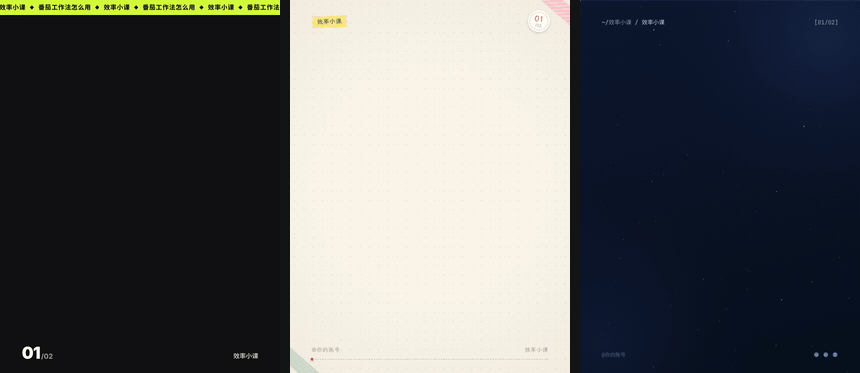
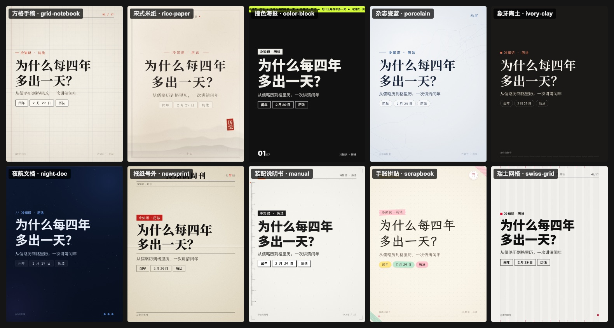
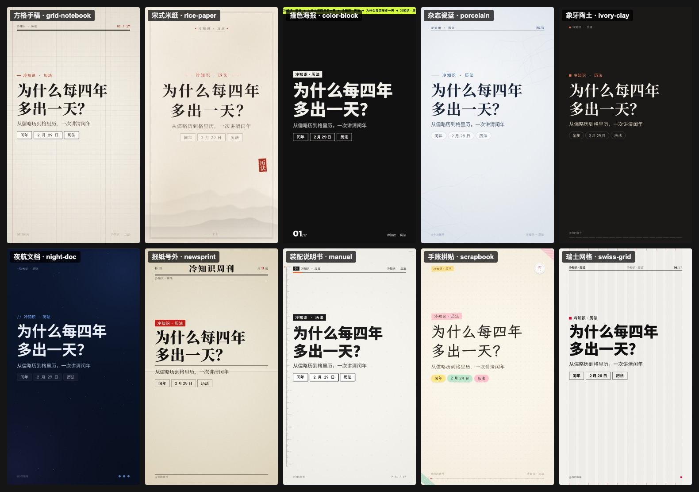
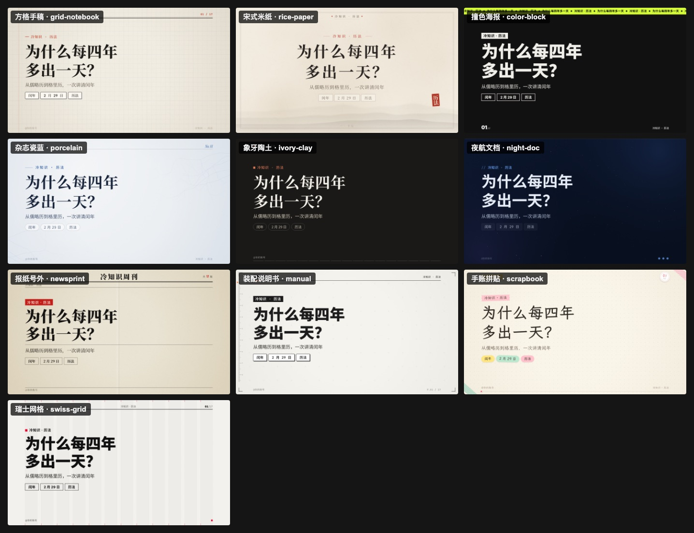
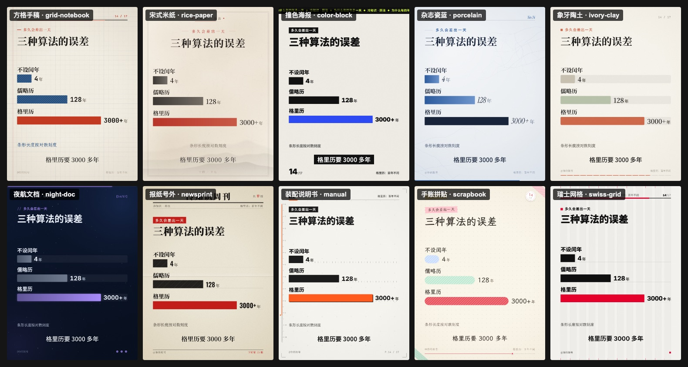
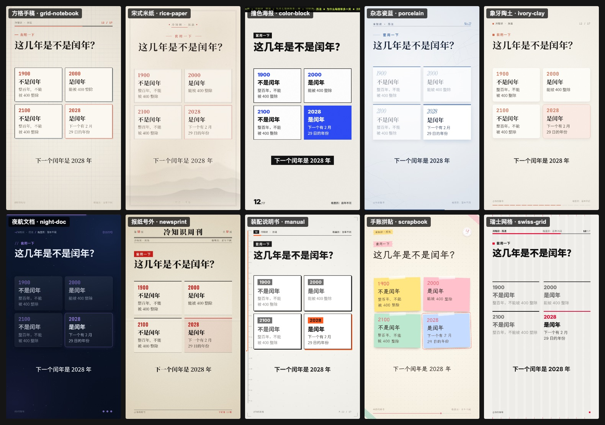
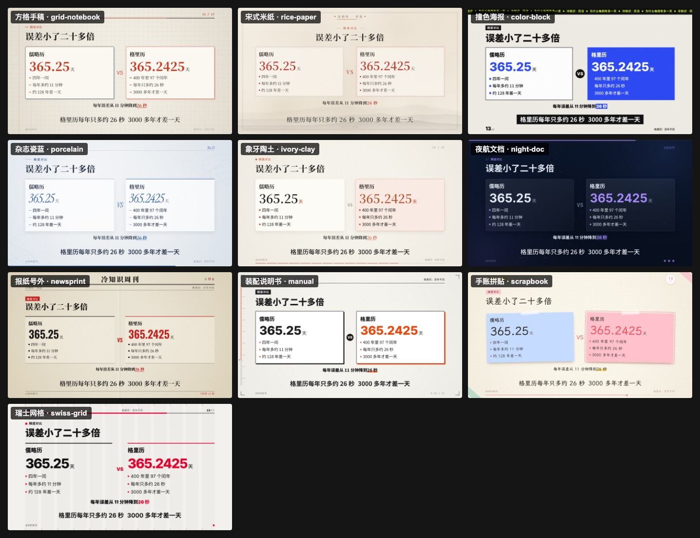

# z-motion-video

让大家轻松做动效讲解视频的 Agent Skill。把口播稿、文章或几条要点整理成一份 `story.json`（场景 + 口播），得到带字幕、页码、进度条和转场的 MP4。Claude Code 等支持 `SKILL.md` 的 Agent 都能使用，也可以直接在命令行里运行。

适合知识科普、产品介绍、操作教程、数据解读、观点输出、读书分享、生活分享等短视频。

<p align="center">
  
</p>

<p align="center"><sub>同一份两页短稿（番茄工作法），用「撞色海报 / 手账拼贴 / 夜航文档」三种风格渲染后并排播放。</sub></p>

[能做什么](#能做什么) · [10 套风格](#10-套风格) · [三种画幅](#三种画幅) · [安装](#安装) · [在 Agent 里使用](#在-agent-里使用) · [命令行快速上手](#命令行快速上手) · [story.json](#storyjson-最小示例与写法) · [模板](#模板一览) · [配音与时间轴](#配音与时间轴) · [命令速查](#命令速查与产物位置) · [自定义](#自定义) · [目录结构](#目录结构) · [隐私说明](#隐私说明) · [许可](#许可)

下文的 `$SK` 指 skill 所在目录，设置方法见[安装](#安装)。

## 能做什么

- **一份 `story.json` 出一支视频**：写场景和口播，引擎生成网页动画，Playwright 逐帧截图，ffmpeg 合成 MP4。
- **画面跟着口播走**：元素在口播说到对应文字时出场，字幕、页码、进度条、转场自动生成。
- **17 个模板**：封面、章节、金句、大数字、数据卡、列表、步骤、卡片、对比、条形图、时间线、引用、代码、公式、图片、结尾，外加自写 HTML 的 `custom`。
- **10 套风格**：改一个 `style` 字段，整套外观跟着换。
- **3 种画幅**：3:4、9:16、16:9。同一份 `story.json` 三种画幅都能直接出。
- **多种配音方式**：macOS `say`（本地）、edge-tts（在线），也能接自己的逐句录音、整段录音或字级时间戳。没有配音时先出静音版，节奏按字数估算。导出时可用 `--bgm` 混入背景音乐。
- **逐帧确定性渲染**：同一时刻永远是同一张画面。多进程并行导出，`verify` 抽帧和页面做 PSNR 比对。
- **先检查再出片**：`snap` 出截图和排版警告，`compare` 出风格对比图，`preview` 在浏览器里播放。

## 10 套风格

每套风格是 `styles/<风格 ID>/` 下的 `style.json`、`style.css`、`style.js`。在 `story.json` 里写 `"style": "<风格 ID>"`，或在命令里加 `--style <风格 ID>`。`python3 $SK/tools/mv.py styles` 可以随时列出全部风格。

| 风格 ID | 名称 | 看点 | 适合 |
|---|---|---|---|
| `grid-notebook` | 方格手稿 | 米白方格纸、墨黑宋体、红笔批注，像在笔记本上边讲边画 | 知识科普、原理讲解、学习笔记、读书分享 |
| `rice-paper` | 宋式米纸 | 宣纸底、居中宋体、朱砂印章和着重号、远山淡墨 | 人文历史、传统文化、读书笔记、节气民俗 |
| `color-block` | 撞色海报 | 每页换一块高饱和底色、粗黑体大字、黑底字幕条，节奏快 | 观点输出、清单盘点、产品发布、活动预告 |
| `porcelain` | 杂志瓷蓝 | 冷白瓷底、藏青宋体、斜体数字和冰裂纹，安静的杂志感 | 品牌故事、人物专访、生活方式、艺术设计 |
| `ivory-clay` | 象牙陶土 | 象牙白配陶土橙，封面、章节、金句切成深色页 | 科技解读、产品介绍、行业观察、知识讲解 |
| `night-doc` | 夜航文档 | 深海军蓝、星点和点阵，每章换一种强调色，玻璃卡片 | 技术教程、AI 工具、产品发布、数据报告 |
| `newsprint` | 报纸号外 | 旧报纸纸面、报头和分栏线、粗黑宋体、网点图片 | 新闻解读、热点事件、历史故事、观点评论 |
| `manual` | 装配说明书 | 说明书白纸、圆形步骤号、安全橙重点、虚线箭头、刻度尺进度 | 操作教程、产品上手、流程拆解、工具测评 |
| `scrapbook` | 手账拼贴 | 点阵本、便利贴卡片、和纸胶带、荧光笔、拍立得相框、手写字 | 生活分享、学习笔记、旅行攻略、好物推荐 |
| `swiss-grid` | 瑞士网格 | 12 栏参考线、粗黑无衬线、Inter 大数字、一抹瑞士红 | 品牌介绍、数据解读、行业观察、设计分享 |

几个风格有专属字段：

- `rice-paper`：`story.seal` 写 2～4 个字，封面和结尾会盖一方朱砂印。
- `newsprint`：`story.masthead` 是报头名，不写时依次取 `series`、`title`。
- `color-block`：场景写 `"bg": "ink"`、`"paper"`、`"blue"`、`"lime"` 或 `"red"` 指定底色，不写时自动轮换。
- `ivory-clay` 的 `bg` 取 `light`、`dark`、`clay`；`manual` 取 `light`、`dark`、`orange`；`swiss-grid` 取 `light`、`dark`、`red`；`scrapbook` 写 `"bg": "light"` 可取消章节页的便利贴底色。
- `night-doc`：场景写 `"accent": "#7CF3C8"`（6 位十六进制色值）换强调色，不写时每章自动换色。

### 封面对比

同一份稿子（内置示例 `examples/leap-year`，闰年的由来），10 套风格各出一张封面。

**3:4**



**9:16**



**16:9**



<details>
<summary>内容页对比：条形图、卡片、左右对比</summary>

同一份示例稿，10 套风格在内容页上的表现。

**条形图页（3:4，示例第 14 页）**



**卡片页（9:16，示例第 12 页）**



**左右对比页（16:9，示例第 13 页）**



这些对比图由 `mv.py compare` 生成：

```bash
python3 $SK/tools/mv.py new ./demo
python3 $SK/tools/mv.py compare ./demo --ratio all                # 封面，三种画幅
python3 $SK/tools/mv.py compare ./demo --ratio 3:4 --scene 14     # 第 14 页，条形图
python3 $SK/tools/mv.py compare ./demo --ratio 9:16 --scene 12    # 第 12 页，卡片
python3 $SK/tools/mv.py compare ./demo --ratio 16:9 --scene 13    # 第 13 页，左右对比
```

</details>

## 三种画幅

| 画幅 | 尺寸 | 常见用途 | 说明 |
|---|---|---|---|
| `3:4` | 1080×1440 | 公众号、小红书 | 默认画幅 |
| `9:16` | 1080×1920 | 抖音、视频号、快手 | 底部约 560px 留给平台按钮和标题栏，字幕在它上面 |
| `16:9` | 1920×1080 | B 站、YouTube、横屏播放 | 列表、卡片、步骤自动排成多列或横排 |

同一份 `story.json` 三种画幅都能直接出。三种画幅的字数容量不同，换画幅后重新跑一遍 `snap` 检查排版。

`--ratio` 可以写 `3:4`、`9:16`、`16:9`、`all`，也可以用逗号分隔多个，例如 `--ratio 3:4,9:16`。不写时读 `story.json` 的 `ratio` 字段，再没有就用 `3:4`。

## 安装

### 用 skills 安装器

```bash
npx skills add tjxj/z-motion-video
```

需要 Node.js。按安装器的提示选择目标 Agent。

### 手动安装

把仓库克隆到 Agent 读取 skills 的目录。Claude Code 的用户级目录是 `~/.claude/skills/`：

```bash
git clone https://github.com/tjxj/z-motion-video.git ~/.claude/skills/z-motion-video
```

其他 Agent 克隆到它自己的 skills 目录：

```bash
git clone https://github.com/tjxj/z-motion-video.git /path/to/your/skills/z-motion-video
```

### 环境依赖

1. Python 3.9 及以上。
2. Playwright 和 Chromium：

   ```bash
   pip install playwright && python3 -m playwright install chromium
   ```

3. ffmpeg。macOS：`brew install ffmpeg`；Ubuntu：`sudo apt install ffmpeg`；Windows：`winget install ffmpeg`。
4. 可选依赖：

   ```bash
   pip install numpy      # 整段录音对时间必需；逐句音频也会用它去掉首尾静音
   pip install edge-tts   # 在线配音
   ```

目前只在 macOS 上完整实测过。其他系统需要自己装好 Python、Playwright 和 ffmpeg，配音用 `--engine edge` 或自己的录音。

### 检查环境

把 `SK` 指向 skill 所在目录，运行 `check`：

```bash
SK=~/.claude/skills/z-motion-video   # 改成你的 skill 目录
python3 $SK/tools/mv.py check
```

`check` 会列出 Python、ffmpeg、Playwright、Chromium 的状态，以及每种字体来自本机、已缓存还是待下载。字体在第一次构建时自动下载，也可以用 `mv.py fonts` 提前下载，见[隐私说明](#隐私说明)。

## 在 Agent 里使用

装好后，对 Agent 说出触发词，就能触发这个 skill：

> 动效视频、做个动效视频、动画讲解视频、文字转动效视频、口播配动效、口播动画、讲解动画、竖屏动效视频、横屏动效视频、motion video、explainer video

示例说法：

- 「把这篇稿子做成 9:16 的动效视频，用撞色海报风格」
- 「做个动效视频讲番茄工作法，3:4，先出风格对比图让我挑」
- 「口播配动效：这是我的稿子和逐句录音，做成 16:9 的横屏版」

Agent 按 `SKILL.md` 里的流程工作：

1. 问清三件事：讲什么、发在哪（决定画幅）、喜欢什么风格。风格拿不准时，先用 `compare` 出一张对比图让你挑。
2. 用 `new` 建项目，把稿子拆成场景，写 `story.json`。
3. 用 `snap` 出截图，逐条处理终端里的排版警告（内容溢出、缩放比例、标题行过长）：删字、拆场景或换模板。
4. 配音和时间轴：用你的录音、机器配音，或先出静音版。用 edge-tts 之前，Agent 会先征得你的同意，因为它会把口播文字发到微软在线语音服务。
5. 用 `preview` 预览（可选），用 `render` 导出，用 `verify` 核对。

## 命令行快速上手

```bash
SK=~/.claude/skills/z-motion-video          # 改成你的 skill 目录

python3 $SK/tools/mv.py new ./my-video      # 新建项目，复制示例 story.json 和素材
# 编辑 ./my-video/story.json，换成你自己的场景和口播
python3 $SK/tools/mv.py snap ./my-video     # 逐页截图，总览图在 ./my-video/out/sheet-*.png
python3 $SK/tools/mv.py tts ./my-video      # 可选：macOS say 本地配音，跳过则出静音版
python3 $SK/tools/mv.py render ./my-video   # 导出 MP4 到 ./my-video/out/
python3 $SK/tools/mv.py verify ./my-video   # 抽 6 帧和页面逐帧比对
```

示例项目的风格是 `grid-notebook`，画幅是 `3:4`，导出文件名的前缀取自 `story.json` 的 `name`，所以示例导出的文件是 `out/leap-year-grid-notebook-3x4.mp4`。换成自己的稿子后，记得同时改 `name`。

常用变化：

```bash
# 换风格和画幅
python3 $SK/tools/mv.py render ./my-video --style color-block --ratio 9:16

# 一次出三种画幅
python3 $SK/tools/mv.py render ./my-video --ratio all

# 拿不准风格：同一份稿子出全部风格的对比图
python3 $SK/tools/mv.py compare ./my-video --ratio 9:16

# 浏览器预览，空格播放
python3 $SK/tools/mv.py preview ./my-video
```

`tts` 默认用 macOS 的 `say`。其他系统请用 `--engine edge`，或用自己的录音，见[配音与时间轴](#配音与时间轴)。

## story.json 最小示例与写法

```json
{
  "title": "三分钟看懂复利",
  "name": "compound",
  "series": "理财入门",
  "byline": "@你的账号",
  "ratio": "9:16",
  "style": "ivory-clay",
  "scenes": [
    { "type": "cover", "kicker": "理财入门", "title": "三分钟\n看懂复利", "say": "复利到底有多厉害？三分钟讲清楚。" },
    { "type": "bignum", "value": "37.8", "unit": "倍", "label": "每天进步 1%，一年后", "say": "每天进步百分之一，一年后是原来的 37.8 倍。" },
    { "type": "list", "title": "复利的三个条件", "mode": "number",
      "items": ["本金", "收益率", "【时间】"],
      "say": ["复利要三样东西：本金、收益率，", "还有最重要的，【时间】。"] },
    { "type": "ending", "title": "越早开始越好", "cta": "关注我，下期讲定投", "say": "所以，越早开始越好。" }
  ]
}
```

把它存成 `./my-video/story.json`，就可以对 `./my-video` 运行 `snap`、`render`。完整示例见 `examples/leap-year/story.json`（17 个场景，用到了大部分模板）。

### 写法要点

- **一页一件事**：每个场景口播 1～3 句，时长 5～15 秒最舒服。信息多就拆成两页。
- **屏幕字是口播的提炼**：标题 6～14 字，列表 3～5 项，每项一行。口播讲细节，屏幕只放关键词、数字和结论。
- **顺序一致**：列表、卡片、步骤、时间线的条目顺序要和口播里提到的顺序一致。引擎在口播说到对应文字时让它出场，匹配时忽略空格和标点，不区分大小写。
- **点亮关键词**：屏幕文字里用 `【】` 包住要强调的词，口播说到它时会被高亮。口播里也写 `【】` 时，字幕里的这个词同样高亮，配音时括号会去掉。
- **对不上时手动指定**：给元素写 `xxAt`，例如 `"titleAt": "闰年"`、`"at": "3.5s"`、`"at": "60%"`。
- **开头和结尾**：第一页用 `cover`，最后一页用 `ending`。每 3～5 页可以插一个 `chapter`，页眉会显示当前小节名。
- **图片**：放在项目的 `assets/` 目录，写相对路径，例如 `"image": "assets/xxx.png"`。
- **口播句子不带画面说明**：`say` 里的文字会直接送去配音和做字幕，不要写屏幕说明、括号注释或网址，它们会被念出来。
- **转场**：每套风格有默认转场，场景里写 `trans` 覆盖，可选 `cut`、`fade`、`fadeblur`、`rise`、`cross`、`push`、`slide`、`paper`、`columns`、`wipe`。
- **字幕**：来自 `say`，按标点切成短句。顶层写 `"subtitles": false` 关闭。

### 顶层字段

| 字段 | 说明 |
|---|---|
| `scenes` | 场景数组，必需 |
| `title` | 视频标题，用于网页标题和页眉兜底 |
| `name` | 输出文件名前缀，默认用项目目录名 |
| `series` | 系列名，显示在页眉 |
| `byline` | 署名，显示在页脚和结尾页 |
| `ratio` | 默认画幅：`3:4`、`9:16`、`16:9` |
| `style` | 默认风格 ID，例如 `grid-notebook` |
| `subtitles` | 写 `false` 关闭字幕 |
| `pace` | 估算时间轴的参数，见[配音与时间轴](#配音与时间轴) |
| `seal`、`masthead` | `rice-paper`、`newsprint` 专用，见[10 套风格](#10-套风格) |

每个场景都能写 `type`、`say`、`kicker`、`title`、`sub`、`note`，以及 `section`、`dur`、`hold`、`stamp`、`bg`、`accent`、`trans`、`cls`、`tone`、`focus`、`hot`、`titleSplit`。`say` 可以写字符串，也可以写字符串数组，数组里每个元素是一句，对应一段配音和一组字幕。全部字段和出场时刻的写法见 [docs/story.md](docs/story.md)。

## 模板一览

| type | 用途 | 主要字段 |
|---|---|---|
| `cover` | 封面 | kicker、title、sub、tags、image、meta |
| `chapter` | 章节页 | num、title、sub、note |
| `statement` | 一句话金句、观点 | text（多行用 `\n`） |
| `bignum` | 一个大数字 | value、unit、label、note |
| `stats` | 2～6 个数据卡 | items[{value, unit, label, note, on}] |
| `list` | 要点、编号、对错清单 | mode（bullet、number、check、cross）、items |
| `steps` | 步骤流程，带连线箭头 | items[{title, text}]、dir |
| `cards` | 概念、特点、方案卡片 | items[{tag, title, text, icon}]、cols |
| `compare` | 左右对比 | left、right{label, value, unit, points, win}、verdict |
| `bars` | 横向条形图 | items[{label, value, unit, on}]、scale: log |
| `timeline` | 时间线 | items[{time, text}]、dir |
| `quote` | 引用 | text、source |
| `code` | 代码，逐行打字 | code、lang、file、hl |
| `formula` | 公式（KaTeX） | tex、items |
| `image` | 图片、截图，可配要点 | image、frame、cap、points |
| `ending` | 结尾 | title、tags、cta、byline |
| `custom` | 自写 HTML | html、css |

所有模板都能写 `kicker`（小标签）、`title`、`sub`、`note`、`say`。列表类模板（`stats`、`list`、`steps`、`cards`、`bars`、`timeline`）的条目可以写 `"on": true` 标成重点，写 `"at": "关键词"` 指定出场时刻；场景里写 `focus` 让列表「讲到哪项亮哪项」，写 `hot` 按序号标重点。`value` 写成 `"365.2422"`、`"$1.2"`、`"98%"` 这类带前后缀的数字时，出场有计数动画。`image` 模板有 `plain`、`window`、`phone`、`paper`、`polaroid`、`halftone` 六种相框。

每个模板的字段和示例见 [docs/templates.md](docs/templates.md)。

## 配音与时间轴

`timing.json` 记录每句口播和每个场景的起止时间，引擎按它安排出场、字幕和转场。生成方式有四种，后三种来自真实配音，会覆盖估算结果。

| 方式 | 命令 | 说明 |
|---|---|---|
| 估算（默认） | `timing ./my-video --estimate` | 没有配音时按字数估算，`snap`、`render` 发现 `say` 变了会自动重新估算。输出的视频是静音的，适合先看画面节奏 |
| 逐句音频 | `timing ./my-video --lines ./recordings` | 目录里的音频数要和 `say` 句数一致，按文件名里的数字排序对应。支持 wav、mp3、m4a、aiff、flac、ogg、opus。这种方式最稳 |
| 整段音频 | `timing ./my-video --audio voice.wav` | 一整段录音按停顿切句，再对到 `say` 上。需要 `numpy`。停顿不明显时会切不准，改用另外两种 |
| 字级时间戳 | `timing ./my-video --words words.json --voice voice.wav` | 用语音识别给出的字或词级时间，出场时刻最准 |

整段音频和字级时间戳都要求每个场景至少有一句 `say`。

`words.json` 是数组，每项写 `{"w": "闰", "s": 1.23, "e": 1.41}`。字段名也可以是 `word`、`text`，`start`、`start_time`，`end`、`end_time`；外层是对象时读取其中的 `words`、`result` 或 `segments`。时间是毫秒时会自动换算。识别文字和 `say` 有出入也没关系，引擎按字对齐，没对上的字插值补齐。

### 机器配音 tts

```bash
python3 $SK/tools/mv.py tts ./my-video
python3 $SK/tools/mv.py tts ./my-video --engine edge --voice zh-CN-XiaoxiaoNeural --rate 10
```

| 引擎 | 说明 |
|---|---|
| `say`（默认） | macOS 自带，本地合成。默认音色 `Tingting`，`say -v '?'` 列出可用音色，`--rate` 是每分钟字数。只在 macOS 上可用 |
| `edge` | 需要 `pip install edge-tts`。默认音色 `zh-CN-YunxiNeural`，`--rate 10` 表示加快 10%。会把口播文字发到微软在线语音服务 |

合成结果写到 `audio/lines/001.wav` 起的逐句文件，随后自动按逐句音频生成 `audio/voice.wav` 和 `timing.json`。`tts` 每次都会先清空 `audio/lines/`，自己的逐句录音请放在别的目录，再用 `timing --lines` 指定。用其他配音工具时，把逐句文件放进一个目录，运行 `timing --lines` 即可。

### 估算参数 pace

没有配音时，引擎按 `story.json` 里的 `pace` 估算时间轴。写 `"pace": { "cps": 4.0 }` 这样的字段可以覆盖默认值：

| 参数 | 默认 | 含义 |
|---|---|---|
| `cps` | 4.5 | 每秒念几个字（英文单词和数字有单独的换算） |
| `lead` | 0.35 | 每页开始到第一句口播的间隔（秒） |
| `gap` | 0.25 | 同一页句子之间的间隔 |
| `hold` | 0.6 | 每页最后一句之后的停留 |
| `min` | 2.5 | 每页最短时长 |
| `tail` | 1.5 | 全片结尾多留的时间 |

逐句音频也按 `lead`、`gap`、`hold`、`min`、`tail` 排版。

### 背景音乐

```bash
python3 $SK/tools/mv.py render ./my-video --bgm music.mp3 --bgm-db -20
```

音乐会循环铺满全片，开头 1.5 秒淡入，结尾 2.5 秒淡出。有配音时音量为 `--bgm-db`，默认 -18 dB。没有配音时，音量为 `--bgm-db` 再加 6 dB，默认 -12 dB。

### 注意事项

- 改了 `say` 之后要重新运行 `tts` 或 `timing`。估算模式会自动重新估算；来自录音的时间轴在句数或场景数对不上时会报错提醒。
- 没有配音时，`render` 导出的视频没有人声；加了 `--bgm` 才有背景音乐。

## 命令速查与产物位置

```text
python3 $SK/tools/mv.py check                                   检查环境
python3 $SK/tools/mv.py styles                                  列出风格
python3 $SK/tools/mv.py new <项目> [--example leap-year]         新建项目
python3 $SK/tools/mv.py fonts [--style S | --all]               预下载字体
python3 $SK/tools/mv.py tts <项目> [--engine say|edge] [--voice V] [--rate R]
python3 $SK/tools/mv.py timing <项目> [--estimate | --lines DIR | --audio FILE | --words JSON --voice FILE]
python3 $SK/tools/mv.py build <项目> [--style S] [--ratio R]     构建网页（snap、compare、preview、render 会自动调用）
python3 $SK/tools/mv.py snap <项目> [--style S] [--ratio R] [--at 3.5,8]
python3 $SK/tools/mv.py compare <项目> [--ratio R] [--styles a,b] [--scene N]
python3 $SK/tools/mv.py preview <项目> [--style S] [--ratio R] [--port 8765]
python3 $SK/tools/mv.py render <项目> [--style S] [--ratio R|all] [--workers N] [--fps 30] [--bgm FILE] [--bgm-db -18]
python3 $SK/tools/mv.py verify <项目> [--style S] [--ratio R]
```

默认值：

- `--style`、`--ratio` 不写时读 `story.json` 的 `style`、`ratio`，再没有就用 `grid-notebook`、`3:4`。
- `--fps` 默认 30。`render` 和 `verify` 要用同一个值。
- `render --workers` 默认「CPU 核数 − 2」，最少 1 个，最多 8 个。机器卡顿时调小。
- `preview` 启动本地服务并打印地址 `http://127.0.0.1:8765/index.html#preview`（端口用 `--port` 改），在浏览器里打开，空格播放，左右方向键快进，Ctrl+C 结束。只预览 `--ratio` 里的第一个画幅。
- `snap --at 3.5,8` 截指定时间点的帧，适合检查转场；`compare --scene N` 对比第 N 个场景，不写时对比封面。
- `verify` 抽 6 帧（开头、结尾和中间 4 个等分点）和页面逐帧比对，PSNR 全部 ≥ 30 dB 算通过。

产物位置（`<画幅>` 写成 `3x4`、`9x16`、`16x9`，`<name>` 取 `story.json` 的 `name`，没有就用项目目录名）：

| 命令 | 产物 |
|---|---|
| `snap` | `out/sheet-<风格>-<画幅>.png`（总览图）；`out/snap/<风格>-<画幅>/` 里有封面 `cover.png` 和逐页 `sNN.png` |
| `compare` | `out/compare-<画幅>.png`（指定 `--scene N` 时为 `out/compare-<画幅>-sN.png`）；`out/compare/<画幅>/<风格>.png` |
| `tts`、`timing` | `audio/lines/NNN.wav`、`audio/voice.wav`、`timing.json` |
| `build` | `build/<风格>-<画幅>/`，可直接打开的网页 |
| `render` | `out/<name>-<风格>-<画幅>.mp4`，H.264 编码，有配音或背景音乐时带 AAC 音轨 |
| `verify` | `out/verify/` 里每个抽样帧一对图：视频帧 `v_NNNNN.png` 和页面帧 `p_NNNNN.png` |

## 自定义

- **微调某个风格**：在项目目录里放 `custom.css`、`custom.js`，它们在风格之后加载，不用改 skill 本身。场景元素有稳定的 class（`.scene.tpl-list`、`.title`、`.item`、`.card` 等），配合场景的 `cls` 字段可以只改某一页。
- **注册自己的模板**：在 `custom.js` 里调用 `MV.template('名字', (d, api) => {…})`，之后场景里写 `"type": "名字"`。
- **自写 HTML 的页面**：用内置的 `custom` 模板，写 `html` 和 `css` 字段。元素上加 `data-role`、`data-rv`、`data-at` 参与出场，写法见 [docs/templates.md](docs/templates.md)。
- **做一套新风格**：复制一个现有风格目录再改，接口见 [docs/styles.md](docs/styles.md)。

```bash
cp -r $SK/styles/grid-notebook $SK/styles/my-style
python3 $SK/tools/mv.py new ./style-demo
python3 $SK/tools/mv.py snap ./style-demo --style my-style --ratio all
python3 $SK/tools/mv.py compare ./style-demo --styles grid-notebook,my-style --scene 6
```

自写的动画只能由时间 `t` 决定，不要读当前时间，也不要用 `Math.random()`；需要随机数时用 `MV.util.rng(种子)` 返回的固定种子随机函数，否则并行渲染的各段画面会对不上。

## 目录结构

仓库：

```text
z-motion-video/
├── SKILL.md              Agent 读取的说明：工作流、写法规则、命令速查
├── README.md
├── LICENSE
├── tools/
│   └── mv.py             命令行入口
├── engine/               排版骨架、时间轴、逐帧渲染（core.js、templates.js、base.css）
├── styles/               10 套风格，每套有 style.json、style.css、style.js
├── examples/
│   └── leap-year/        内置示例：story.json 和 assets/（17 个场景）
├── docs/
│   ├── story.md          story.json 字段、出场时刻、时间轴
│   ├── templates.md      17 个模板的字段
│   ├── styles.md         做一套新风格
│   └── gallery/          README 里的配图
└── vendor/
    └── katex/            KaTeX 0.19.1，公式模板用
```

你的项目目录：

```text
my-video/
├── story.json        必需：标题、风格、场景和口播
├── assets/           图片素材，story 里写 assets/xxx.png
├── audio/            配音（tts、timing 生成）
├── timing.json       时间轴（自动生成）
├── custom.css        可选：在风格样式之后加载
├── custom.js         可选：在风格脚本之后加载
├── build/            构建出的网页（自动生成）
└── out/              截图、对比图、视频（自动生成）
```

## 实测参考

| 项目 | 数据 |
|---|---|
| 机器 | 12 核 Mac |
| 视频 | 9:16，175 秒，5248 帧，30 fps |
| 渲染 | 8 个进程并行，约 5 分 20 秒（同时还有别的任务在跑） |
| `verify` | 抽 6 帧比对，最低 PSNR 39.8 dB |

耗时随 CPU、画幅和页面内容变化，以上数据只作参考。

## 隐私说明

- `say` 在本地合成，口播文字不出本机。
- `--engine edge` 会把口播文字发到微软在线语音服务。
- 字体在第一次构建时从 npm 镜像下载，先试 npmmirror，失败再试 npmjs，保存到 `~/.cache/z-motion-video/fonts`。本机已装同款的思源宋体、思源黑体、霞鹜文楷（按固定文件名查找）时直接用本机的，其余字体一律下载。`python3 $SK/tools/mv.py fonts` 可以提前把字体下载好。
- 除此之外，`mv.py` 不联网。`preview` 只监听 `127.0.0.1`。`story.json` 里的图片写成 `https://` 地址时，渲染会访问这个地址，用 `assets/` 里的相对路径则不会。

两个环境变量：

| 变量 | 作用 |
|---|---|
| `MV_CACHE` | 缓存目录，默认 `~/.cache/z-motion-video`，字体保存在其下的 `fonts/` |
| `MV_NO_LOCAL_FONTS=1` | 强制不用本机字体，改用下载版，方便检查别人机器上的效果 |

## 许可

- 代码：MIT，见 [LICENSE](LICENSE)。
- `vendor/katex/`：KaTeX 0.19.1，MIT。
- 字体：不随仓库分发，运行时下载（或使用本机已装的同款），均为 SIL OFL 1.1：Noto Serif SC、Noto Sans SC、LXGW WenKai、JetBrains Mono、Oswald、Instrument Serif、Inter、Courier Prime。
- 示例：`examples/leap-year` 里的文字和日历配图是为演示自制的。
